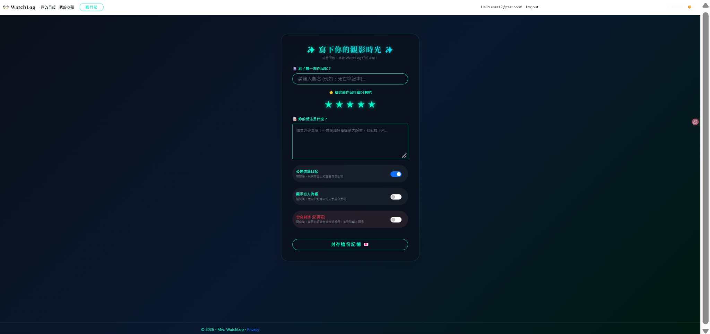
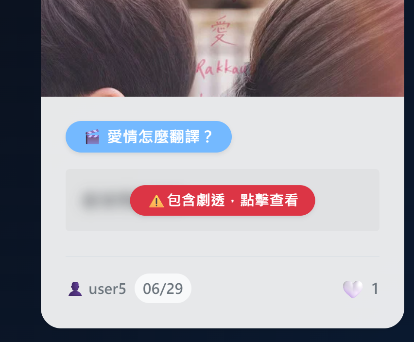
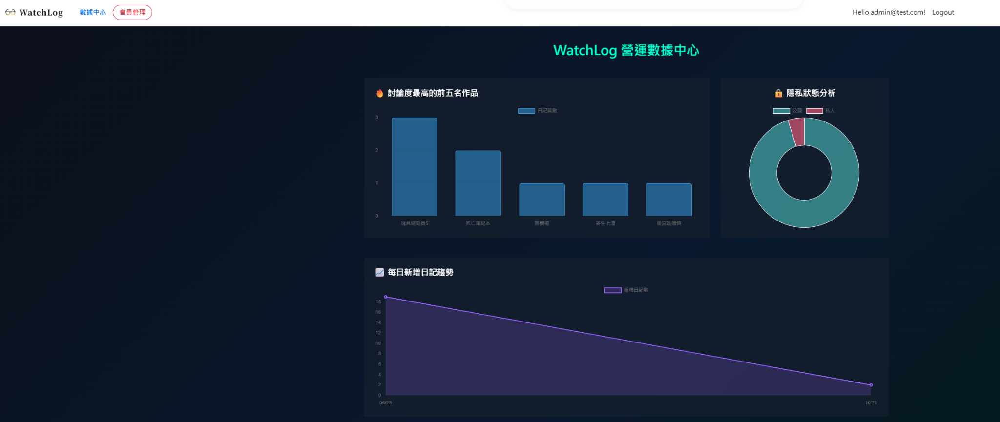
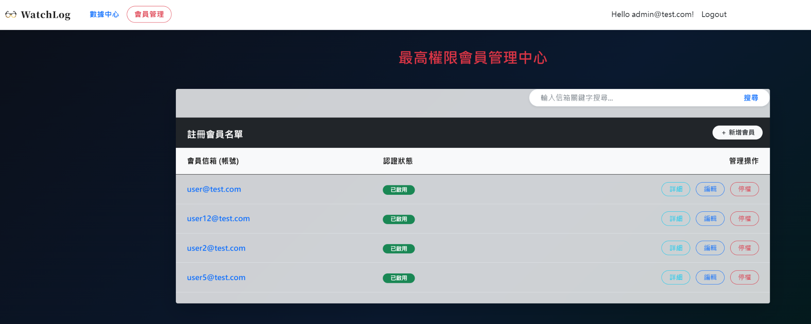

# WatchLog｜影視觀影日記與分享平台

WatchLog 是使用 **ASP.NET Core MVC（C#）** 開發的影視觀影紀錄網站。使用者可以記錄自己看過的電影或影集、撰寫心得與評分，並自由決定是否公開分享、顯示作品海報，以及遮蔽可能涉及劇透的內容。

除了個人日記，WatchLog 也提供公開心得的愛心收藏功能；管理者則可以透過後台查看網站營運數據並管理會員。

## 主要功能

### 一般使用者

- **觀影日記**：輸入電影或影集名稱，撰寫觀影心得並給予星等評分。
- **作品搜尋**：整合 **TMDB API**，協助搜尋影視作品資訊。
- **公開／私人設定**：可選擇是否將日記公開至首頁；不公開的日記保留於個人紀錄中。
- **劇透遮蔽**：公開心得可啟用劇透遮蔽，讓其他使用者自行決定是否查看內容。
- **海報顯示設定**：可選擇是否顯示作品海報。
- **愛心收藏**：可對其他使用者公開的心得按愛心，並在「我的收藏」中查看。
- **我的日記**：集中瀏覽自己撰寫的觀影紀錄。

### 管理者

- **營運數據中心**：以圖表呈現熱門討論作品、日記公開／私人比例及每日新增日記趨勢。
- **會員管理**：瀏覽會員名單、依電子郵件搜尋會員、查看詳細資訊、編輯會員資料，以及停權管理。

## 系統畫面

### 1. 新增觀影日記

使用者可填寫作品、評分與心得，並設定公開狀態、海報顯示及劇透遮蔽。



### 2. 劇透遮蔽效果

啟用劇透遮蔽後，其他使用者會先看到提示，再自行選擇是否查看內容。



### 3. 管理者營運數據中心

提供熱門作品排行、公開狀態分析與日記新增趨勢等視覺化資訊。



### 4. 會員管理中心

提供會員搜尋、詳細資料、編輯與停權等管理操作。



## 使用技術

| 類別 | 技術 |
| --- | --- |
| 後端 | C#、ASP.NET Core MVC |
| 前端 | Razor Views、HTML、CSS、JavaScript |
| 資料存取 | Entity Framework Core |
| 資料庫 | SQL Server LocalDB（本機開發環境） |
| 會員驗證 | ASP.NET Core Identity |
| 外部服務 | TMDB API（影視作品搜尋） |
| 版本控制 | Git、GitHub |

## 設定與安全性

TMDB API Key 不直接寫入程式碼，而是透過 **ASP.NET Core User Secrets** 在本機開發環境中管理。

執行前需自行準備 TMDB API Key，並設定對應的 User Secrets：

```json
{
  "TMDB": {
    "ApiKey": "YOUR_TMDB_API_KEY"
  }
}
```

本專案使用 SQL Server LocalDB 作為本機開發資料庫；執行時請依自己的環境調整 `appsettings.json` 中的資料庫連線設定，並建立所需的資料庫結構。

## 專案說明

本專案為個人作品，目的是實作一套結合影視日記、分享互動與後台管理的 ASP.NET Core MVC 網站，練習從資料管理、使用者驗證與權限區分，到外部 API 整合與資料視覺化等功能。
